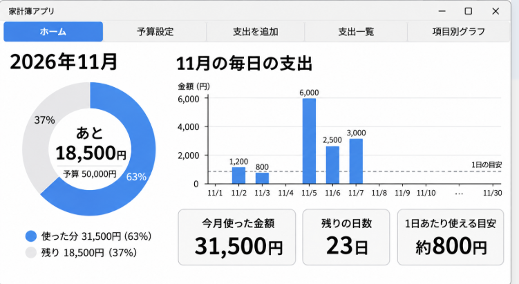
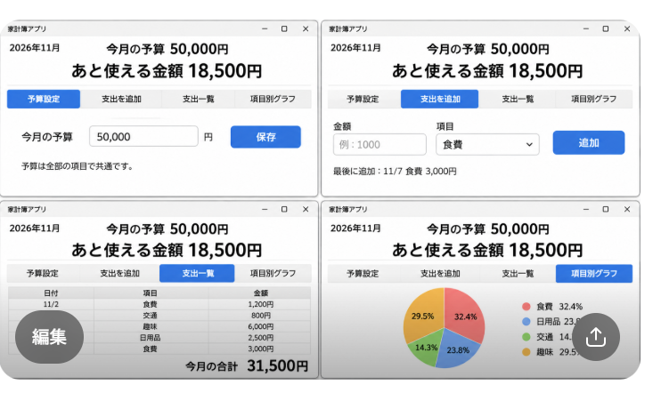
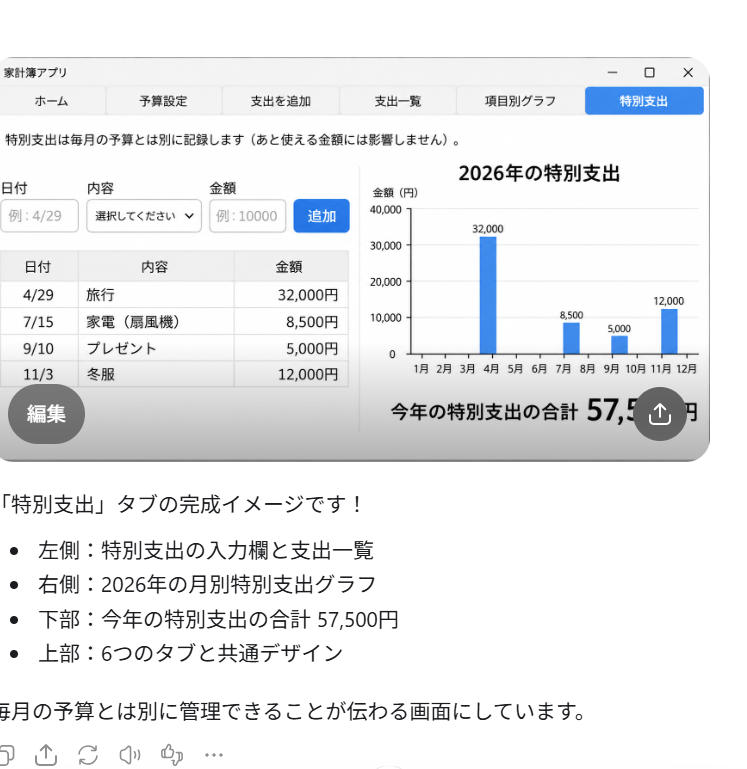

# kakeibo-Java

毎月の予算から「あと使える金額」がすぐ分かる、自分用の家計簿アプリです。
Java の Swing で作っています。

## 完成イメージ

## 画面（タブ6つ）

- ホーム：今月の「あと使える金額」、予算の使い具合、毎日の支出のグラフ
- 予算設定：今月の予算を1つ決める（全項目で共通）
- 支出を追加：金額と項目（食費・日用品・交通・趣味）を入れる
- 支出一覧：日付・項目・金額の表と、今月の合計
- 項目別グラフ：項目ごとの割合を円グラフで見る
- 特別支出：旅行や家電など、毎月の予算とは別に記録する

## 使う技術

- Java 25
- Swing（画面）
- JUnit（テスト）

## 今後

- Spring Boot とデータベースを使った Web 版にする予定